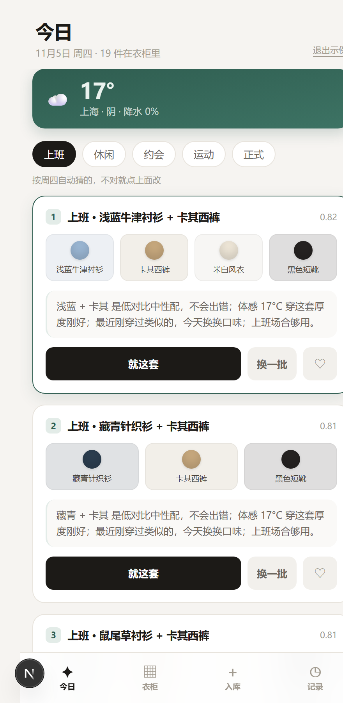
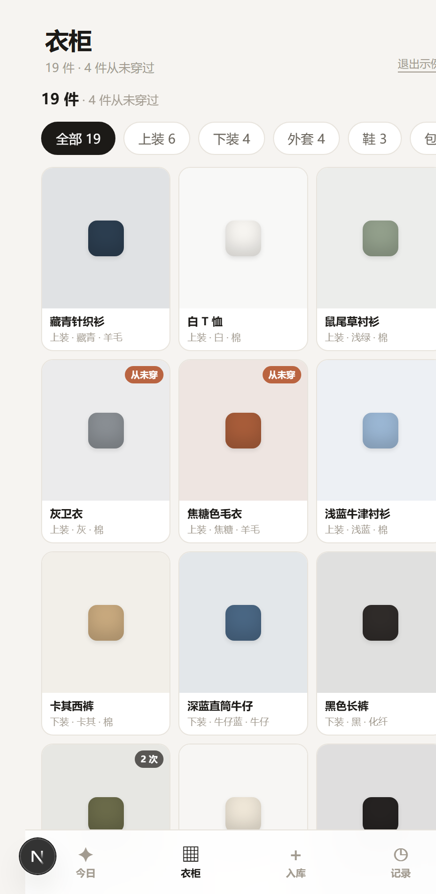
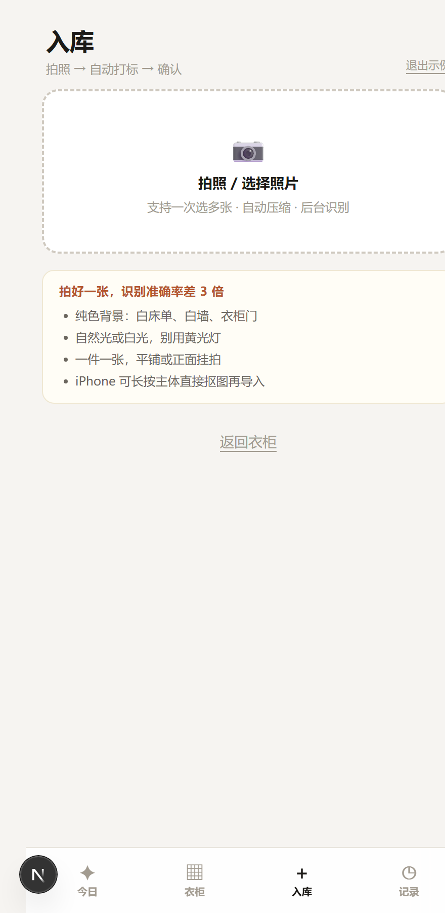
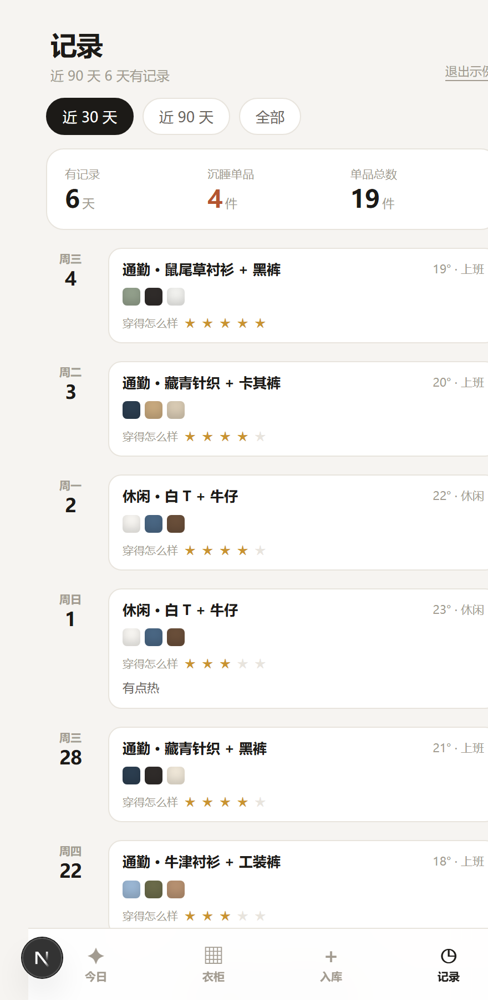

# 衣柜 · 今天穿什么

把衣柜数字化，每天早上直接给你三套，并且它知道你上周穿过什么。

这是一个 **PWA**（网页 App，可以加到手机桌面）。选 PWA 而不是小程序，是因为个人自用不需要备案和审核，改一版立刻生效。

---

## 现在能做什么

| 能力 | 说明 |
| --- | --- |
| 每日三套 | 规则筛 → 打分排序 → 大模型挑 3 套并写中文理由 |
| 场合自动猜 | 按星期几推：周六日→休闲，周五 18 点后→约会，其余→上班。点一下就改 |
| 天气 | 走 Open-Meteo，不需要 API key；取不到就按 18°C 兜底 |
| 入库 | 拍照 → 可选自动打标（视觉模型）→ 手动确认 |
| 记录 | 「就这套」一键记；记录页看穿了什么、评分、沉睡单品 |
| 云同步 | Supabase，换设备数据还在；RLS 保证只有本人能读写 |

**明确不做**：AI 试衣、3D 身材建模、社交、电商、高精度抠图。
理由写在 [`docs/产品方案.md`](docs/产品方案.md)，核心是一句话——试衣不产生决策增量。

---

## 界面

| 今日 | 衣柜 | 入库 | 记录 |
| --- | --- | --- | --- |
|  |  |  |  |

---

## 本地跑起来

### 0. 环境

Node 18+（推荐 20+）。

```bash
npm install
```

### 1. 建 Supabase 项目

1. 打开 [supabase.com](https://supabase.com) 新建项目（免费额度够个人用）。
2. 进 **SQL Editor**，把 [`supabase/schema.sql`](supabase/schema.sql) 整段粘贴执行。
   这一步会建表、开 RLS、加穿一次自动累加的 trigger、建 `wardrobe` 图片桶。
3. 进 **Project Settings → API**，抄两个值：`Project URL`、`anon public key`。

> `anon key` 是公开的，可以放前端；真正的权限由 RLS 管。

### 2. 配环境变量

```bash
cp .env.local.example .env.local
```

填两行必填：

```
NEXT_PUBLIC_SUPABASE_URL=https://xxxxxxxxxxxx.supabase.co
NEXT_PUBLIC_SUPABASE_ANON_KEY=eyJhbGciOi...
```

### 3.（可选）接大模型

不填也能用——理由会退回模板生成（「低对比、厚度刚好、场合够用」这种），推荐逻辑完全不受影响。

```
LLM_BASE_URL=https://dashscope.aliyuncs.com/compatible-mode/v1
LLM_MODEL=qwen-plus
LLM_API_KEY=sk-...
```

任何 OpenAI 兼容的 endpoint 都行。要自动打标的话，`LLM_MODEL` 需要视觉模型（如 `qwen-vl-max`）；没配时入库页会退回手动选标签。

### 4.（可选）默认坐标

没有定位权限时用它，默认上海。

```
NEXT_PUBLIC_DEFAULT_LAT=31.2304
NEXT_PUBLIC_DEFAULT_LON=121.4737
NEXT_PUBLIC_DEFAULT_CITY=上海
```

### 5. 起

```bash
npm run dev
```

打开 http://localhost:3000 。

---

## 先看效果（不用建 Supabase）

两种方式：

- 访问 `http://localhost:3000/?demo=1`
- 或点登录页底部的「先用示例数据看看 →」

示例模式用 50 件单品（男 15 / 女 10 / 中性 25）+ 6 条穿着记录，全部存在 localStorage，刷新不丢，也不上传任何东西。
想退出：清掉浏览器里 `wardrobe:demo` 这个 key，或者调 `useAuth().exitDemo()`。

### 示例图片从哪来

`public/demo/demo-01.jpg` ~ `demo-50.jpg` 取自 **CC0（公有领域）** 数据集
[alexeygrigorev/clothing-dataset-small](https://github.com/alexeygrigorev/clothing-dataset-small)
的测试集，按类目挑了 T 恤、长袖、衬衫、长裤、短裤、半裙、连衣裙、外套、鞋、帽子各若干张。

原始图片是 400×400 左右的方形白底商品图，全部裁到 400px 宽、转成 JPEG（单张 13–44 KB，
20 张合计约 480 KB），保证示例模式不需要联网也不拖慢首屏。

```bash
# 想换一批，直接从 raw 拉即可
https://raw.githubusercontent.com/alexeygrigorev/clothing-dataset-small/master/test/<class>/<uuid>.jpg
```

`<class>` 可选：`t-shirt` `longsleeve` `shirt` `pants` `shoes` `dress` `shorts` `outwear` `hat` `skirt`。

> 换图后记得同步 `src/lib/demo.ts` 里的 `img` 字段和 `color_hex`——
> 数据集大多是白底浅色，取主色时要跳过接近白色的像素（否则每件都会被判成「白」）。

---

## 命令

```bash
npm run dev     # 开发
npm run build   # 生产构建
npm run start   # 跑构建产物
npm run lint    # tsc --noEmit，只做类型检查
npm run test    # vitest，96 个测试
```

测试覆盖的是纯函数：颜色和谐、保暖插值、打分权重、场合猜测、理由生成、打标解析、
性别过滤与配饰槽位、老库兼容降级。跑测试不需要网络，也不需要 Supabase。

### 打包 Android APK

```bash
powershell -ExecutionPolicy Bypass -File scripts\build-apk.ps1
```

产物会复制到桌面 `衣柜.apk`。脚本做五件事：临时移走 `src/app/api`（静态导出不支持
Route Handler）→ `BUILD_STATIC=1 next build` → 恢复 api → `cap sync` → `gradlew assembleDebug`。

**构建前必须先停掉 dev server**，否则 `.next/trace` 被占用会报 `EPERM`。脚本会自动停。

打包需要：
- JDK 17（不是 8 —— Android Gradle Plugin 8.x 要求 17+）
- Android SDK：`platforms;android-34`、`build-tools;34.0.0`
- Gradle 8.2.1（wrapper 自动下载，脚本已改用腾讯云镜像，官方源在国内会超时）

---

## 目录

```
src/
  app/
    page.tsx                入口
    layout.tsx              字体 / manifest / viewport
    api/recommend/route.ts  推荐接口（规则 + LLM 重排）
    api/weather/route.ts    天气代理（Open-Meteo，30 分钟缓存）
    api/tag/route.ts        拍照自动打标（视觉模型，没配就 501）
  components/
    Root.tsx                登录门 → AppShell
    AuthGate.tsx            magic-link 登录 + 示例模式
    AppShell.tsx            四个 tab、状态、动作
    TodayScreen.tsx         今日：天气 + 场合 + 三套
    ClosetScreen.tsx        衣柜：按类目分组
    AddScreen.tsx           入库：拍照 → 打标 → 确认
    LogScreen.tsx           记录：时间线 + 评分 + 沉睡单品
    OutfitCard.tsx          搭配卡（色块预览、理由、就这套 / 换一套）
    ItemSheet.tsx           单品详情弹层
  lib/
    types.ts                Item / WearLog / Outfit / RecommendContext
    color.ts                HSL、中性色判定、色相和谐
    occasion.ts             场合猜测、正式度、季节
    weather.ts              Open-Meteo 封装
    weatherClient.ts        天气三层降级（服务端 → 直连 → 兜底）
    recommend.ts            硬筛 → 打分 → 去重
    recommendRun.ts         推荐编排（Web 与 APK 共用，无环境依赖）
    recommendClient.ts      推荐三层降级（API → 本地规则）
    reason.ts               模板理由、颜色中文名
    llm.ts                  prompt、JSON 解析、失败降级
    tagging.ts              视觉打标 prompt 与解析
    data.ts                 Supabase 读写 + 图片压缩上传
    offlineStore.ts         离线镜像 + 待同步队列
    sync.ts                 队列重放、云端拉取
    schemaFallback.ts       老库缺列/缺枚举时的降级
    demo.ts                 示例数据（50 件单品，图片见 public/demo）
    display.ts              类别/状态的中文展示
  components/
    ItemEditor.tsx          单品属性编辑表单（详情页与录入页共用）
supabase/schema.sql         一次性建好全部表、策略、触发器、存储桶
supabase/migrate-gender.sql 增量迁移：gender 列 + 首饰/帽子/围巾枚举
capacitor.config.ts         APK 打包配置（webDir = out）
scripts/build-apk.ps1       一键出 APK（静态导出 → cap sync → gradle）
android/                    Capacitor 生成的 Android 工程
public/demo/                50 张 CC0 示例单品图（demo-01.jpg ~ demo-50.jpg）
docs/产品方案.md             产品思路、算法、技术选型、排期
原型.html                    最早的点击原型，现在只作设计存档
```

---

## 推荐是怎么算的

### 1. 硬筛

先砍掉不可能的组合：

- `status != active`（已收纳）的直接排除
- 季节不含当季的排除
- 正式度偏离目标超过 1.2 的排除
- 保暖度偏离目标超过 2 的排除

`warmthTarget` 按体感温度查表：≥28→1.5、≥22→2.0、≥16→2.8、≥10→3.6、≥4→4.3、其余→5.0。

### 2. 保暖插值（不是相加）

```
inner = 0.45 * upper + 0.45 * lower + 0.1 * shoes
带外套时 = inner + 0.45 * (outer.warmth - inner)
```

相加会让「薄衬衫 + 薄裤子 + 薄外套」算出高保暖，明显不对。插值更接近真实体感。

### 3. 打分

| 维度 | 权重 | 看什么 |
| --- | --- | --- |
| 场合 | 0.30 | 单品正式度与目标的接近程度 |
| 颜色 | 0.25 | HSL 色相和谐（同色需拉开明度、邻近、互补加点缀） |
| 保暖 | 0.20 | 整套保暖度与目标的差 |
| 新鲜度 | 0.15 | 单品的「沉睡天数」，最近穿过扣分 |
| 偏好 | 0.10 | 点过喜欢的加分 |

权重和恒为 1。

### 4. 去重

按三层放宽挑出三套，避免三套长得一样：先要求上下装都新鲜 → 再只要求核心两件新鲜 → 最后只要求不重复。

### 5. 大模型重排（可选）

把候选和理由素材丢给 LLM，让它挑 3 套并写更具体的理由。
12 秒超时，失败或没配 key 就用模板理由，主流程不会卡住。

---

## 几个刻意的取舍

**不记价格。** 每次穿着成本是个好指标，但要先输入价格，而输入价格是入库时最容易被放弃的一步。少一个字段，录 100 件的心理成本低很多。

**理由必须具体。** 「这套很好看」是废话。每条理由都要落到颜色对比、厚度、场合匹配上，否则用户学不到东西，也就不会信任下一次推荐。

**必须记得穿过什么。** 没有穿着记录，推荐就是每天抽奖，新鲜度维度也直接失效。所以「就这套」的点击成本压到一次性，评分可以之后补。

**录入压到 90 分钟内。** 100 件衣服，平均一件 50 秒。这决定了入库页只能有一个决策点（确认标签），不能是表单。

**离线优先，联网再同步。** 写操作先落 localStorage 并压进队列，界面立刻响应；Supabase 可达时再按顺序重放。地铁里改了几件衣服，出站连上 WiFi 自动补推。不做双向冲突合并——单人自用，同一个数据不会被两台设备同时改，那属于过度设计。

---

## 数据模型

三张表 + 一个桶：

- `items` — 单品。颜色、正式度、保暖、季节、图案、版型、状态、累计穿着、**适用性别**
- `wear_logs` — 穿着记录。日期 + 单品 id 数组 + 场合 + 温度 + 评分
- `feedback` — 显式反馈（喜欢 / 不喜欢），用于偏好维度
- `wardrobe` 桶 — 图片，公开读、登录后写

`wear_logs` 上有个 `after insert` 触发器，自动把 `items.times_worn + 1` 并把 `last_worn` 推到最新日期——记录和统计不会不同步。

---

## 部署

Vercel 最省事：

1. 推到 GitHub
2. Vercel 导入仓库
3. 环境变量里填 `.env.local` 那几行
4. Deploy

上线后在 Supabase 的 **Authentication → URL Configuration** 里把 `Site URL` 和 `Redirect URLs` 改成正式域名，否则 magic link 会跳回 localhost。

手机上加到桌面（Safari 分享 → 添加到主屏幕 / Chrome 菜单 → 添加到主屏幕），就是 App 的用法。

---

## 已知限制

- 单品没有真实抠图。有 `image_url` 时卡片直接用原图，`cutout_url` 字段留着，以后接抠图服务再填。
- 自动打标要视觉模型，没配就只有手动。**APK 里永远走手动**——把 API key 打进 APK 等于公开它。
- APK 是 debug 签名，能装能用，但不能上架应用商店。要发布得生成 keystore 走 `assembleRelease`。
- 围巾只在冬季出现。现在是别的季节时，约会场合不会加围巾——这是季节规则的正确行为。
- 场合只按星期几猜，没有接日历。
- 数据在 Supabase，离线不可用（PWA 只缓存了壳）。
